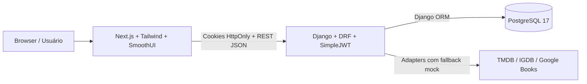

# Rankit

Recriação moderna do **Rankit** (`joaopedrov0/rankit`), uma plataforma social para catalogar, avaliar e acompanhar obras de **Filmes, Séries, Animes, Jogos e Livros**.

## Arquitetura



- **Backend (`backend/`)**: Python 3.13 (`uv`), Django, Django REST Framework, SimpleJWT (cookies `HttpOnly`), Django ORM + PostgreSQL 17, `ruff`, `mypy`, `pytest` + `pytest-cov`.
- **Frontend (`frontend/`)**: Next.js (App Router), TypeScript strict, Tailwind CSS, SmoothUI (`smoothui.dev`), Vitest + React Testing Library.
- **Orquestração (`docker-compose.yml`)**: `db` (PostgreSQL 17), `backend`, `frontend`.
- **E2E (`e2e/`)**: Playwright rodando contra a stack completa.
- **CI/CD (`.github/workflows/ci.yml`)**: Lint, typecheck, testes unitários, integração em PostgreSQL real, E2E em Docker Compose e ratchet de cobertura mínima (>= 80%).

## Roadmap Incremental

1. **Fase 1 — Ambiente & Qualidade**: `AGENTS.md`, Docker Compose, Django + PostgreSQL, Next.js + SmoothUI, CI/CD e cobertura >= 80%.
2. **Fase 2 — Core v1**: Autenticação (JWT HttpOnly), Perfis e Grafo de Follow/Sugestões, Catálogo de Mídias (TMDB/IGDB/Google Books + mocks locais), Reviews, Diário e Feed.
3. **Fase 3 — Backlog da v1**: Watchlist / Assistindo agora, Busca de usuários, Top Rated e Favoritos.

## Rodando Localmente

```bash
cp .env.example .env
docker compose up -d --build
```

- Frontend: `http://localhost:3000`
- Backend API Health: `http://localhost:8000/api/v1/health/`

## Comandos de Qualidade

Consulte [AGENTS.md](./AGENTS.md) ou o [Makefile](./Makefile) para rodar lint, tipagem, testes unitários, testes de integração e E2E.
